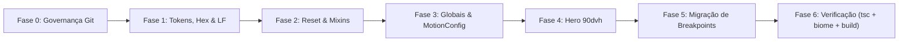

# Plano Arquitetural: Design System Canônico (Base 8pt & Responsividade Fluida)

> **Projeto**: `lp-conf` (Landing Page de Alta Confeitaria)  
> **Papel**: Senior Frontend Architect & Design Systems Engineer  
> **Status**: Revisão 2 — alinhamento de 16/11/2026 (`/grill-me`): escopo de breakpoints ampliado, `reducedMotion="never"` temporário, LF canônico e hex minúsculo.  
> **Fontes Canônicas**: CUBE CSS (Andy Bell), Josh W. Comeau (*The Surprising Truth About Pixels & A11y*), Adrian Roselli (*Responsive Type and Zoom*), WCAG 2.2 AA (1.4.4 Resize Text & 2.3.3 Reduced Motion), W3C CSS Values & Units Level 4, Motion 14 Docs, Biome 2.6.2.

---

## 1. Delimitação Estrita de Escopo

> [!IMPORTANT]
> **Fronteira Arquitetural do Escopo**:  
> Este plano **não refatora regras de negócio ou conteúdos internos das seções `About` e `Menu`**.  
> O escopo inclui a fundação do Design System, a padronização responsiva e a governança de estilos:
> 1. Sistema de Tokens (`src/styles/_tokens.scss`): Grade de 8pt, cores em hex minúsculo e correção de CLS.
> 2. Reset Estrutural (`src/styles/_reset.scss`): Altura dinâmica de viewport (`dvh`) e preservação do root em 100%.
> 3. Mixins Canônicos (`src/styles/_mixins.scss`): Breakpoint canônico de `40rem`, mixins de componentes atômicos (`@mixin button-base`, `@mixin eyebrow`) e focus rings acessíveis.
> 4. Estilos Globais (`src/styles/globals.scss`): Despoluição de classes soltas e consumo estrito de tokens.
> 5. Governança Centralizada de Animações (`src/App.tsx`): Configuração no root com `<MotionConfig reducedMotion="never">` temporário e remoção de flags locais.
> 6. Fundação da Hero (`src/sections/Hero.module.scss`): Aplicação de `90dvh` e tokens dimensionais base 8pt.
> 7. Migração de Breakpoints: eliminação de `960px`, `900px`, `680px`, `480px` e `820px` em `About`, `Menu`, `Header`, `ThemeToggle`, `Carrosel`, `WhatsAppCTA`, `CarroselDock` e `Sandbox`, preservando o conteúdo e usando layout intrínseco + `40rem`.
> 8. Governança de Line Endings: normalização para LF via `.gitattributes` e validação com `npm run check`.

---

## 2. Decisões Arquiteturais Validadas no `/grill-me`

### 2.1. A Regra dos Múltiplos de 8 com Root em 100%
* **Decisão**: Rejeitado o hack `html { font-size: 50% }` em favor da abordagem recomendada por **Josh W. Comeau, Kevin Powell e Andy Bell (CUBE CSS)**.
* **Justificativa Técnica**:
  - Manter `html { font-size: 100%; }` preserva o padrão nativo da web ($1\text{rem} = 16\text{px}$).
  - Elimina 100% do risco de distorção de pacotes externos como `lucide-react`.
  - Contorna o bug crítico de *Minimum Font Size* de navegadores móveis (WebKit e Chromium), que ignoram tamanhos calculados abaixo do piso do sistema.
  - A escala de 8pt é garantida através de tokens CSS padronizados em frações exatas de `rem`:
    - `--space-0-5: 0.25rem;` (4px - microespaçamento)
    - `--space-1: 0.5rem;` (8px - unidade base)
    - `--space-1-5: 0.75rem;` (12px)
    - `--space-2: 1rem;` (16px)
    - `--space-3: 1.5rem;` (24px)
    - `--space-4: 2rem;` (32px)
    - `--space-5: 2.5rem;` (40px)
    - `--space-6: 3rem;` (48px)
    - `--space-7: 3.5rem;` (56px)
    - `--space-8: 4rem;` (64px)

### 2.2. Tipografia Fluida Acessível com `clamp()` Misto
* **Decisão**: Proibido o uso de `vw` isolado no argumento preferencial de `clamp()`. Toda equação tipográfica deve conter a soma de `rem + vw` (ex.: `clamp(1rem, 0.5rem + 2.5vw, 2.5rem)`).
* **Justificativa Técnica (Adrian Roselli & WCAG 1.4.4)**:
  - Unidades `vw` puras não respondem ao zoom de texto do navegador. Ao compor com um termo fixo em `rem`, o texto é obrigado a expandir quando o usuário aplica zoom de 200%, cumprindo o critério **WCAG 2.2 Nível AA 1.4.4 (Resize Text)**.

### 2.3. Eliminação da Dispersão de Breakpoints
* **Decisão revisada (escopo ampliado)**: Erradicar breakpoints manuais e dispersos (`960px`, `900px`, `680px`, `480px`, `820px`) em todos os componentes que os utilizam, incluindo `About` e `Menu`, estabelecendo um **breakpoint canônico e estritamente pontual**:
  - `$bp-mobile: 40rem;` ($640\text{px} / 16 = 40\text{rem}$).
  - A eliminação não altera conteúdo, copy ou regras de negócio; apenas estilos estruturais e responsividade.
* **Justificativa Técnica (Every Layout & Ethan Marcotte)**:
  - Elementos estruturais devem se adaptar por design intrínseco (Flexbox com wrap e CSS Grid `minmax`). O breakpoint mobile é reservado para a inversão de direção da Hero e compactação de navegação.

### 2.4. Isolamento Modular (CUBE CSS)
* **Decisão**: Remover `.button` e `.eyebrow` de `globals.scss`. Transformá-los em mixins reutilizáveis (`@mixin eyebrow`, `@mixin button-base`) dentro de `_mixins.scss`.
* **Justificativa Técnica**:
  - Elimina colisão de especificidade entre o CSS global e os módulos locais (`About.module.scss`, `MenuHeader.module.scss`).

### 2.5. Governança de Animações com Motion 14
* **Decisão revisada**: Configurar `<MotionConfig reducedMotion="never">` no `App.tsx` para governança centralizada e explícita. O valor `"never"` é temporário para permitir testes de animação; nenhum componente deve manter flags locais (`shouldReduceMotion = false`) nem lógica própria de `useReducedMotion()`. Quando o período de testes terminar, a política migra para `reducedMotion="user"` em um único ponto.
* **Justificativa Técnica (Motion 14 / WCAG 2.2)**: A centralização evita divergência entre `useReducedMotion()` e `MotionConfig`; o estado temporário fica documentado e reversível.

---

## 3. Especificação Canônica dos Arquivos da Fundação

### 3.1. `src/styles/_tokens.scss`

> **Formato canônico**: cores em hex minúsculo. `rgb()` fica reservado para cores com alpha explícito.  
> **Exceção de lint documentada**: o Biome 2.6.2 acusa falso positivo `noUnknownUnit` para hex iniciados por dígito; a regra fica desativada apenas para `src/styles/_tokens.scss` via `overrides` no `biome.json`.

```scss
:root {
  color-scheme: light;

  // --- Paleta Semântica (hex minúsculo canônico) ---
  --color-background: #f8f4e8;
  --color-surface: #eae2b7;
  --color-text: #1f2937;
  --color-muted: #6b7280;
  --color-accent: #d62828;
  --color-border: #1f2937;

  // --- Superfícies Dinâmicas dos Slides ---
  --color-surface-default: #eae2b7;
  --color-surface-slide-1: #751a1a;
  --color-text-slide-1: #ffffff;
  --color-surface-slide-2: #5a3620;
  --color-text-slide-2: #ffffff;
  --color-surface-slide-3: #2e5129;
  --color-text-slide-3: #ffffff;

  // --- Tokens de Marca (WhatsApp) ---
  --color-whatsapp: #25d366;
  --color-whatsapp-hover: #22bf5b;
  --color-whatsapp-dark: #128c7e;
  --color-whatsapp-text: #0b2b16;

  // --- Escala de Espaçamento 8pt (1rem = 16px padrão) ---
  --space-0-5: 0.25rem; // 4px
  --space-1: 0.5rem;   // 8px (base)
  --space-1-5: 0.75rem;// 12px
  --space-2: 1rem;     // 16px
  --space-2-5: 1.25rem;// 20px
  --space-3: 1.5rem;   // 24px
  --space-4: 2rem;     // 32px
  --space-5: 2.5rem;   // 40px
  --space-6: 3rem;     // 48px
  --space-7: 3.5rem;   // 56px
  --space-8: 4rem;     // 64px
  --space-10: 5rem;    // 80px
  --space-12: 6rem;    // 96px

  // --- Raios de Borda (Múltiplos de 8) ---
  --radius-sm: 0.5rem;     // 8px
  --radius-base: 1rem;     // 16px
  --radius-large: 1.5rem;  // 24px
  --radius-max: 2rem;      // 32px (IDÊNTICO no Light e Dark para CLS = 0)
  --radius-pill: 9999px;

  // --- Constantes Estruturais do Layout ---
  --bento-gap: var(--space-2);            // 16px (1rem)
  --layout-stage-margin: var(--space-1);  // 8px (0.5rem)
  --container-width: 72.5rem;             // 1160px (72.5rem)

  // --- Tipografia Fluida Acessível (rem + vw com clamp) ---
  --font-display: clamp(2.5rem, 1.5rem + 4vw, 5.5rem); // 40px -> 88px
  --font-h1: clamp(1.75rem, 1rem + 2.5vw, 3rem);        // 28px -> 48px
  --font-h2: clamp(1.35rem, 0.85rem + 1.5vw, 2rem);     // 21.6px -> 32px
  --font-h3: clamp(1.15rem, 0.85rem + 0.8vw, 1.5rem);   // 18.4px -> 24px
  --font-lead: clamp(1rem, 0.8rem + 0.6vw, 1.25rem);    // 16px -> 20px
  --font-body: clamp(0.95rem, 0.85rem + 0.3vw, 1rem);   // 15.2px -> 16px
  --font-caption: clamp(0.75rem, 0.65rem + 0.25vw, 0.85rem); // 12px -> 13.6px

  // --- Easing e Transições ---
  --ease-smooth: cubic-bezier(0.22, 1, 0.36, 1);
  --ease-spring: cubic-bezier(0.16, 1, 0.3, 1);
  --duration-fast: 0.2s;
  --duration-normal: 0.4s;
  --duration-slow: 0.6s;
}

[data-theme="dark"] {
  color-scheme: dark;

  // Apenas overrides cromáticos. Variáveis estruturais NUNCA variam com o tema.
  --color-background: #003049;
  --color-surface: #1d4533;
  --color-surface-default: #1d4533;
  --color-surface-slide-1: #5c1313;
  --color-surface-slide-2: #7a6c1c;
  --color-surface-slide-3: #5c2e15;
  --color-text: #f0f3ed;
  --color-muted: #a9b4aa;
  --color-accent: #c7f880;
  --color-border: rgb(48 58 49);
}
```

### 3.2. `src/styles/_reset.scss`
```scss
*,
*::before,
*::after {
  box-sizing: border-box;
}

html {
  // Root 100% preservado para integridade nativa e respeito total ao zoom do SO
  font-size: 100%;
  scroll-padding-top: var(--space-4, 2rem);

  @media (prefers-reduced-motion: no-preference) {
    scroll-behavior: smooth;
  }
}

body {
  margin: 0;
  padding: 0;
  min-height: 100vh; // Fallback
  text-rendering: optimizeSpeed;
  -webkit-font-smoothing: antialiased;
}

@supports (min-height: 100dvh) {
  body {
    min-height: 100dvh;
  }
}

button,
input,
textarea,
select {
  font: inherit;
}

img,
svg {
  display: block;
  max-width: 100%;
  height: auto;
}

a {
  color: inherit;
  text-decoration: none;
}
```

### 3.3. `src/styles/_mixins.scss`
```scss
@use "sass:map";

// Breakpoint estritamente pontual (apenas para colapso estrutural mobile)
$breakpoints: (
  "mobile": 40rem, // 640px na base padrão 16px
);

@mixin respond-to($breakpoint) {
  @if map.has-key($breakpoints, $breakpoint) {
    @media (max-width: map.get($breakpoints, $breakpoint)) {
      @content;
    }
  } @else {
    @error "Breakpoint '#{$breakpoint}' não permitido. Use 'mobile'.";
  }
}

@mixin container {
  width: min(var(--container-width), calc(100% - (var(--space-2) * 2)));
  margin-inline: auto;
}

@mixin focus-ring($color: var(--color-accent), $offset: 4px) {
  &:focus-visible {
    outline: 2px solid $color;
    outline-offset: $offset;
  }
}

@mixin eyebrow {
  display: inline-flex;
  align-items: center;
  gap: var(--space-1);
  color: var(--color-accent);
  font-size: var(--font-caption);
  font-weight: 700;
  text-transform: uppercase;
  letter-spacing: 0.12em;
}

@mixin button-base {
  display: inline-flex;
  align-items: center;
  justify-content: center;
  gap: var(--space-1);
  min-height: var(--space-6); // 48px (tap target ideal)
  padding: var(--space-1-5) var(--space-2-5);
  border-radius: var(--radius-pill);
  font-size: var(--font-body);
  font-weight: 700;
  cursor: pointer;
  border: none;
  transition:
    background-color var(--duration-fast) var(--ease-smooth),
    color var(--duration-fast) var(--ease-smooth),
    transform 0.15s ease;

  @include focus-ring();

  &:active {
    transform: scale(0.98);
  }
}
```

### 3.4. `src/styles/globals.scss`
```scss
@use "tokens";
@use "reset";
@use "mixins";

@property --notch-bg {
  syntax: "<color>";
  inherits: true;
  initial-value: #f8f4e8;
}

body {
  background: var(--color-background);
  color: var(--color-text);
  font-family: "Segoe UI", system-ui, sans-serif;
  line-height: 1.6;
  transition: background-color var(--duration-normal) var(--ease-smooth),
              color var(--duration-normal) var(--ease-smooth);
}

::selection {
  background: var(--color-accent);
  color: var(--color-background);
}

@include mixins.focus-ring();

.skip-link {
  position: fixed;
  top: var(--space-2);
  left: var(--space-2);
  z-index: 100;
  padding: var(--space-1) var(--space-2);
  transform: translateY(-200%);
  background: var(--color-accent);
  color: var(--color-background);
  font-weight: 700;
  border-radius: var(--radius-sm);

  &:focus {
    transform: translateY(0);
  }
}
```

---

## 4. Plano de Execução em Fases



### Detalhamento das Etapas:

* **Fase 0: Governança Git**:
  - Criar branch temporária: `git checkout -b refactoring/design-system-foundations` a partir de `dev`.
* **Fase 1: Tokens, Hex e Line Endings**:
  - Atualizar `src/styles/_tokens.scss` com hex minúsculos, escala de 8pt em `rem` (com root 100%), `--radius-max: 2rem` idêntico e remoção de comentários mortos.
  - Adicionar `.gitattributes` com `* text=auto eol=lf` e normalizar o working tree para LF.
  - Validar com `npm run check` e `npm run typecheck`.
* **Fase 2: Reset Estrutural e Mixins**:
  - Atualizar `src/styles/_reset.scss` com root 100%, viewport dinâmico (`100vh` fallback + `100dvh`) e scroll behavior.
  - Atualizar `src/styles/_mixins.scss` com o breakpoint canônico (`40rem`), `@mixin container`, `@mixin eyebrow`, `@mixin button-base` e `@mixin focus-ring`.
* **Fase 3: Globais e Governança do App**:
  - Limpar `src/styles/globals.scss` removendo classes soltas, a cor hardcoded `#daffa6` e elevando o skip link para `z-index: 100`, preservando o fallback global de foco via `focus-ring`.
  - Configurar `<MotionConfig reducedMotion="never">` no `src/App.tsx`, eliminar o estado morto `_activeTextColor` e remover todas as flags locais/`useReducedMotion()` dos componentes.
* **Fase 4: Fundação da Hero**:
  - Atualizar `src/sections/Hero.module.scss` para consumir `90dvh` com fallback e aplicar tokens de margem e raio.
* **Fase 5: Migração de Breakpoints**:
  - Substituir os breakpoints ad hoc por layout intrínseco e pelo breakpoint canônico de `40rem` em `About`, `Menu`, `Header`, `ThemeToggle`, `Carrosel`, `WhatsAppCTA`, `CarroselDock` e `Sandbox`.
  - Substituir as duplicações locais de `.eyebrow` em `About` e `MenuHeader` pelo mixin canônico.
  - Validar visualmente cada faixa e garantir que nenhum conteúdo ou regra de negócio seja alterado.
* **Fase 6: Bateria de Verificação e Walkthrough**:
  - Executar `npm run check`, `npm run typecheck` e `npm run build`.
  - Atualizar `docs/RELATORIO_TECNICO.md` com os tokens, breakpoints e geometria finais.
  - Produzir o walkthrough de entrega.

---

## 5. Critérios de Aceite

1. **Zero Erros de Check**: `npm run check` passa com 100% de conformidade em todo o repositório, incluindo formatação LF.
2. **Zero CLS no Dark Mode**: A alternância de tema no `ThemeToggle` não altera dimensões físicas ou raios de contêiner.
3. **Escala 8pt Estrita**: Todos os espaçamentos, raios e gaps da camada de fundação são múltiplos de 8px expressos em `rem`.
4. **Tipografia Conforme WCAG 1.4.4**: Todo `clamp()` escala proporcionalmente com o zoom do navegador.
5. **Adesão ao Escopo Revisado**: Conteúdo e regras de negócio de `About` e `Menu` permanecem intocados; estilos e breakpoints podem ser ajustados.
6. **Breakpoints Canônicos**: Nenhum breakpoint ad hoc (`960px`, `900px`, `680px`, `480px`, `820px`) permanece no código; layouts intermediários usam design intrínseco e o breakpoint `40rem`.
7. **Reduced Motion Centralizado**: Nenhuma flag local `shouldReduceMotion = false` ou `useReducedMotion()` permanece; a política é declarada apenas no `MotionConfig`.
8. **Line Endings e Cores**: Arquivos texto em LF e cores sólidas em hex minúsculo.
