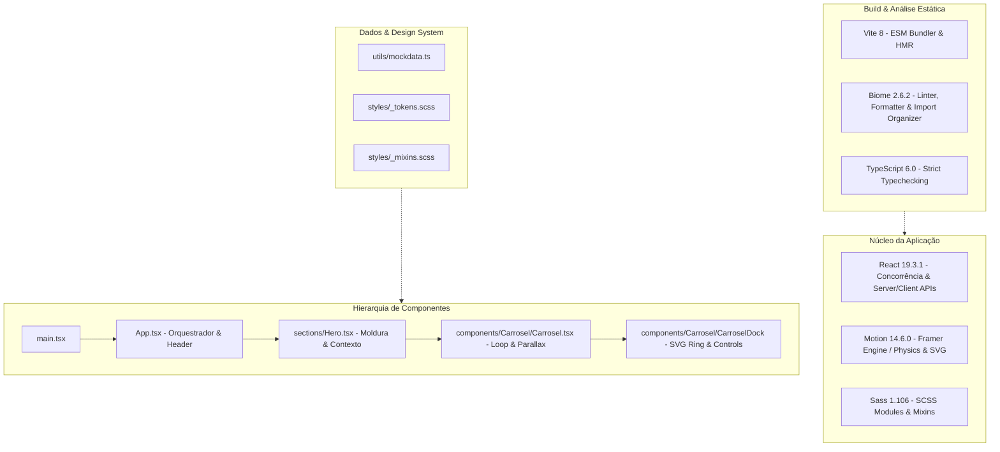
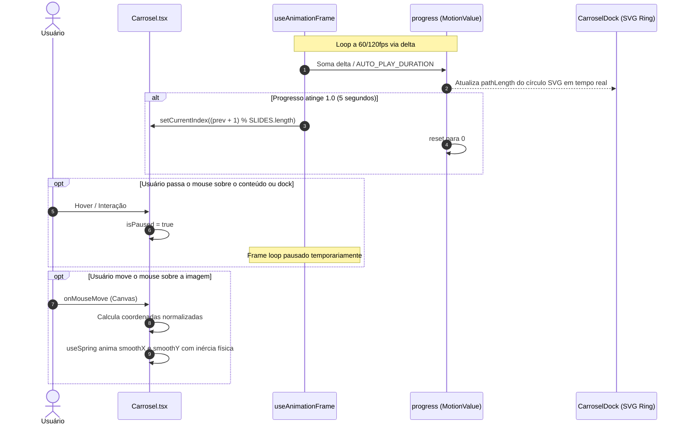

# Relatório Técnico Explicativo: Projeto LP-Conf

> **Projeto**: LP-Conf (Landing Page para Confeitaria Artesanal de Alto Padrão)  
> **Versão**: 0.1.0  
> **Stack Principal**: React 19, TypeScript 6, Vite 8, Motion 14, Sass (SCSS Modules), Biome 2, Lucide React  
> **Data de Elaboração**: Outubro de 2026  

---

## Sumário Executivo

O projeto **`lp-conf`** foi concebido como uma base moderna de Landing Page (Single Page Application — SPA) de alto impacto estético e altíssimo padrão de engenharia de software frontend. A aplicação integra animações fluidas aceleradas por hardware, geometria avançada de cantos côncavos em CSS, um sistema de cores dinâmico acoplado ao slide ativo, e conformidade rigorosa com diretrizes de acessibilidade e performance web.

Este relatório detalha a arquitetura, as decisões técnicas, a lógica matemática e os padrões de implementação de cada módulo do projeto, acompanhado de referências oficiais e acadêmicas para consulta e aprofundamento.

---

## 1. Visão Geral da Arquitetura e Stack Tecnológica



### 1.1. Dependências Principais

- **React 19 (`react` & `react-dom` 19.3.1)**: Utiliza a API moderna de inicialização `createRoot` e o modo de checagem rigorosa `StrictMode`.
- **Motion (`motion` 14.6.0 / `motion/react`)**: Biblioteca líder de animações declarativas para React. Utilizada para o loop de frames via hardware (`useAnimationFrame`), valores reativos desconectados do ciclo de render (`useMotionValue`), física de amortecimento por molas (`useSpring`), transições de montagem/desmontagem (`AnimatePresence`) e manipulação de vetores SVG (`pathLength`).
- **Sass (`sass` 1.106.1)**: Pré-processador CSS compilado nativamente pelo Vite, com suporte a SCSS Modules para escopo local de classes (`.module.scss`), `@use` modular e cálculos matemáticos.
- **Biome (`@biomejs/biome` 2.6.2)**: Ferramenta de alta performance desenvolvida em Rust que substitui de forma integrada e ordens de magnitude mais rápida o ESLint e o Prettier.
- **Vite (`vite` 8.3.5)**: Bundler baseado em Rollup/Rolldown e esbuild, provendo servidor local instantâneo com Hot Module Replacement (HMR).
- **TypeScript (`typescript` 6.0.3)**: Validador de tipagem estática configurado em modo ultra-estrito.

---

## 2. Arquitetura de Configuração e Compilação

### 2.1. Configuração do Bundler (`vite.config.ts`)

Arquivo: [`vite.config.ts`](file:///c:/Users/Dev/develop/lp-conf/vite.config.ts)

```typescript
import { fileURLToPath, URL } from "node:url";
import react from "@vitejs/plugin-react";
import { defineConfig } from "vite";

export default defineConfig({
  plugins: [react()],
  resolve: {
    alias: { "@": fileURLToPath(new URL("./src", import.meta.url)) },
  },
});
```

- **Plugin React Oficial (`@vitejs/plugin-react`)**: Habilita o Fast Refresh para preservar o estado dos componentes React durante edições em desenvolvimento.
- **Alias `@/`**: Resolve importações a partir da raiz `src/` de forma agnóstica ao sistema operacional através das APIs nativas `node:url` (`fileURLToPath` e `new URL`). Isso evita caminhos relativos frágeis como `../../components`.

### 2.2. Configuração do TypeScript (`tsconfig.json`)

Arquivo: [`tsconfig.json`](file:///c:/Users/Dev/develop/lp-conf/tsconfig.json)
- `"target": "ES2023"` e `"module": "ESNext"`: Gera código alinhado aos padrões JavaScript modernos, aproveitando otimizações nativas de navegadores.
- `"moduleResolution": "Bundler"`: Permite a resolução moderna de módulos com suporte a imports de CSS, assets e pacotes ESM.
- `"strict": true`: Ativa todas as verificações rigorosas de tipo do TypeScript.
- `"noUncheckedIndexedAccess": true`: Obriga que qualquer acesso por índice a arrays ou dicionários considere a possibilidade de retorno `undefined`, prevenindo erros de execução clássicos como `Cannot read properties of undefined`.
- `"verbatimModuleSyntax": true`: Garante que tipos e valores sejam importados com distinção sintática explícita (`import type { ... }`), facilitando a elisão de tipos pelo Vite sem riscos de dependências circulares ocultas.
- `"noEmit": true`: Deixa a emissão de código a cargo do Vite, reservando o comando `npm run typecheck` exclusivamente para validação estática de tipos via `tsc`.

### 2.3. Configuração do Biome (`biome.json`)

Arquivo: [`biome.json`](file:///c:/Users/Dev/develop/lp-conf/biome.json)
- Configura indentação padronizada em 2 espaços, limite de largura de linha de 100 caracteres e exclusão de diretórios como `node_modules` e `dist`.
- Habilita o preset `recommended` do linter para capturar problemas de acessibilidade e boas práticas.
- Ativa a ação assistida `source.organizeImports: "on"`, que agrupa e ordena automaticamente os imports em ordem alfabética e por tipo.

### 2.4. Estrutura de Metadados e SEO (`index.html`)

Arquivo: [`index.html`](file:///c:/Users/Dev/develop/lp-conf/index.html)
- **Acessibilidade e Internacionalização**: Tag `<html lang="pt-BR">` definindo o idioma primário para leitores de tela e motores de busca.
- **Metatags Open Graph & Twitter Cards**: Tags estáticas completas (`og:title`, `og:description`, `og:image`, `og:url`, `twitter:card`) no cabeçalho do HTML, assegurando renderização correta de prévias em aplicativos de mensagens e redes sociais sem depender de execução JavaScript.
- **Meta Theme Color**: `<meta name="theme-color" content="#101412">` configurando a cor da barra de status em navegadores móveis.

---

## 3. Sistema de Estilos & Design Tokens

A estilização foi desenhada com uma abordagem modular em Sass associada a Design Tokens baseados em **CSS Custom Properties (Variáveis CSS Nativas)**.

```
src/styles/
├── _tokens.scss  <-- Definição das variáveis de tema claro e escuro
├── _mixins.scss  <-- Mixins utilitários para layouts responsivos
├── _reset.scss   <-- Reset de estilos padrão do navegador
└── globals.scss  <-- Estilos de tipografia, acessibilidade e classes base
```

### 3.1. Variáveis de Design e Temas (`src/styles/_tokens.scss`)

Arquivo: [`src/styles/_tokens.scss`](file:///c:/Users/Dev/develop/lp-conf/src/styles/_tokens.scss)

Os tokens dividem-se em dois escopos principais: `:root` (tema claro) e `[data-theme="dark"]` (tema escuro).

| Variável                                      | Valor Tema Claro               | Valor Tema Escuro         | Função no Projeto                                |
| :-------------------------------------------- | :----------------------------- | :------------------------ | :----------------------------------------------- |
| `--color-background`                          | `#F8F4E8` (Creme suave)        | `#003049` (Azul profundo) | Cor de fundo geral da página e base dos recortes |
| `--color-surface` / `--color-surface-default` | `#1D4533` (Verde floresta)     | `#1D4533`                 | Cor de superfície neutra do Hero                 |
| `--color-surface-slide-1`                     | `#8B1E1E` (Vermelho rubi)      | `#5C1313`                 | Cor de fundo temática do Slide 01                |
| `--color-surface-slide-2`                     | `#BEAA37` (Amarelo mostarda)   | `#7A6C1C`                 | Cor de fundo temática do Slide 02                |
| `--color-surface-slide-3`                     | `#8D4925` (Caramelo artesanal) | `#5C2E15`                 | Cor de fundo temática do Slide 03                |
| `--color-text`                                | `#1F2937`                      | `#f0f3ed`                 | Cor do texto de corpo e títulos                  |
| `--color-accent`                              | `#D62828`                      | `#c7f880`                 | Cor de destaque em botões, foco e anéis          |
| `--color-border`                              | `#D8CF9E`                      | `rgb(48, 58, 49)`         | Bordas da barra de navegação e botões            |
| `--radius-large`                              | `24px`                         | `24px`                    | Raios de componentes intermediários              |
| `--radius-max`                                | `32px`                         | `32px`                    | Raios acentuados de cartões e pílulas            |
| `--container-width`                           | `1160px`                       | `1160px`                  | Largura máxima do layout centralizado            |

### 3.2. Mixins Utilitários (`src/styles/_mixins.scss`)

Arquivo: [`src/styles/_mixins.scss`](file:///c:/Users/Dev/develop/lp-conf/src/styles/_mixins.scss)

```scss
@mixin container {
  width: min(var(--container-width), calc(100% - 2.5rem));
  margin-inline: auto;
}
```

O mixin utiliza a função matemática moderna `min()`, combinando um valor fixo de teto (`1160px`) com uma expressão relativa (`100% - 2.5rem`), garantindo que o container nunca encoste nas bordas laterais em telas menores sem exigir media queries adicionais.

### 3.3. Estilos Globais e Acessibilidade (`src/styles/globals.scss`)

Arquivo: [`src/styles/globals.scss`](file:///c:/Users/Dev/develop/lp-conf/src/styles/globals.scss)
- **Respeito à Preferência de Movimento (`prefers-reduced-motion`)**:

  ```scss
  @media (prefers-reduced-motion: no-preference) {
    html {
      scroll-behavior: smooth;
    }
  }
  ```

  O comportamento de rolagem suave (`scroll-behavior: smooth`) só é ativado se o usuário não tiver configurado seu sistema operacional para reduzir movimentos, prevenindo náusea e desconforto visual em pessoas com distúrbios vestibulares.
- **Skip Link (`.skip-link`)**: Link posicionado fora da tela via `transform: translateY(-200%)` que se torna visível ao receber foco (`transform: translateY(0)`), permitindo que usuários que navegam por teclado pulem diretamente para o conteúdo principal (`#conteudo`).
- **Foco Visível Acessível (`:focus-visible`)**:

  ```scss
  :focus-visible {
    outline: 2px solid var(--color-accent);
    outline-offset: 5px;
  }
  ```

  Atende ao critério de sucesso 2.4.7 das Diretrizes de Acessibilidade de Conteúdo Web (WCAG 2.2), destacando elementos navegados por teclado sem introduzir anéis de foco indesejados ao clicar com o mouse.

---

## 4. Orquestração da Aplicação & Engenharia Geométrica do Header

Arquivos: [`src/App.tsx`](file:///c:/Users/Dev/develop/lp-conf/src/App.tsx) e [`src/App.module.scss`](file:///c:/Users/Dev/develop/lp-conf/src/App.module.scss)

### 4.1. Sincronização Cromática Dinâmica com Intersection Observer

No componente raiz `App`, existem dois estados fundamentais:
1. `activeSurfaceColor`: Armazena a cor ativa do slide atual (ex.: `var(--color-surface-slide-1)`).
2. `isHeroInView`: Booleano que indica se a seção Hero está visível na tela.

Em vez de registrar um evento de `window.addEventListener("scroll", ...)`, que força re-cálculos constantes de estilo e reflow na thread principal (causando jank e queda de taxa de quadros), o componente utiliza a API nativa do navegador **`IntersectionObserver`**:

```tsx
useEffect(() => {
  const target = heroSectionRef.current;
  if (!target) return;

  const observer = new IntersectionObserver(
    ([entry]) => {
      setIsHeroInView(entry.isIntersecting);
    },
    { threshold: 0.15 },
  );

  observer.observe(target);
  return () => observer.disconnect();
}, []);
```

- **Lógica de Transição**: Quando o Hero está com pelo menos 15% de visibilidade, a navegação do header adota a cor viva do slide (`activeSurfaceColor`). Se o usuário rolar a página para baixo e ultrapassar o Hero, o header transita suavemente para a cor padrão neutra (`var(--color-surface-default)`).
- **Desconexão Segura**: O callback de limpeza do `useEffect` chama `observer.disconnect()`, prevenindo vazamentos de memória (memory leaks) quando o componente for desmontado.

### 4.2. Engenharia Geométrica do "Notch" do Header (Curvas Côncavas / Fillets Invertidos)

Um dos pontos mais sofisticados da interface é o header fixo no canto superior esquerdo com um recorte que se funde à moldura do Hero por meio de curvas côncavas perfeitas (cantos invertidos).

#### As Variáveis Matemáticas do Layout

```scss
$hero-margin: 8px;
$nav-height: 52px;
$nav-radius: 26px; // Raio da pílula (metade da altura)
$header-padding-tl: 16px; // Padding Top e Left
$header-padding-rb: 12px; // Padding Right e Bottom
$header-radius: $nav-radius + $header-padding-rb; // 38px (Raio concêntrico externo)
$fillet-size: $header-padding-tl + $nav-radius - $hero-margin; // 34px (Tamanho da curva de concordância)
```

#### Princípio dos Cantos Concêntricos

Para que o contorno do `nav` e a borda externa do container `.header` pareçam visualmente harmônicos e uniformes, o raio do container precisa ser a soma do raio interno com o padding intermediário:  
$$\text{raio externo} = \text{raio interno} + \text{espaçamento} = 26\text{px} + 12\text{px} = 38\text{px}$$

#### Construção dos Cantos Côncavos (Pseudo-elementos `::before` e `::after`)

Em CSS, bordas normais (`border-radius`) só geram curvas convexas (arredondadas para fora). Para gerar uma curva côncava (arredondada para dentro), foi empregada a técnica de **Gradiente Radial com Ponto Focal Transparente**:

```scss
// Curva superior direita (conecta o teto ao corte vertical)
&::before {
  content: "";
  position: absolute;
  top: 0;
  left: 100%;
  width: $fillet-size;
  height: calc(#{$hero-margin} + #{$fillet-size});
  background: radial-gradient(
    circle at 100% 100%,
    transparent $fillet-size,
    var(--color-background) calc($fillet-size + 0.75px)
  );
  pointer-events: none;
}
```

- **Como Funciona o Gradiente**: O círculo do gradiente é posicionado no canto inferior direito (`100% 100%`). O raio até `$fillet-size` é preenchido com `transparent`, deixando ver o que está atrás. A partir de `$fillet-size + 0.75px`, o gradiente é preenchido com a cor de fundo sólida `var(--color-background)`. O acréscimo de `0.75px` cria um efeito de anti-aliasing artificial, eliminando bordas serrilhadas nos pixels da renderização.
- **`pointer-events: none`**: Garante que os pseudo-elementos decorativos não interceptem cliques do usuário destinados aos elementos subjacentes.

### 4.3. Microinterações nos Links de Navegação

```scss
a {
  &::after {
    content: "";
    position: absolute;
    left: 0;
    bottom: -2px;
    width: 100%;
    height: 2px;
    background-color: currentColor;
    border-radius: 999px;
    transform: scaleX(0);
    transform-origin: center;
    transition: transform 0.25s cubic-bezier(0.16, 1, 0.3, 1);
  }

  &:hover::after {
    transform: scaleX(1);
  }
}
```

Ao passar o mouse sobre o link, a barra inferior expande a partir do centro (`transform-origin: center; transform: scaleX(0) -> scaleX(1)`), utilizando aceleração gráfica baseada em transform e uma curva de desaceleração suave (`cubic-bezier(0.16, 1, 0.3, 1)`).

---

## 5. Seção Hero

Arquivos: [`src/sections/Hero.tsx`](file:///c:/Users/Dev/develop/lp-conf/src/sections/Hero.tsx) e [`src/sections/Hero.module.scss`](file:///c:/Users/Dev/develop/lp-conf/src/sections/Hero.module.scss)

### 5.1. Estrutura e Estilização

```tsx
export function Hero({ onSlideColorChange, activeColor, heroRef }: HeroProps) {
  return (
    <section
      ref={heroRef}
      className={styles.hero}
      id="inicio"
      aria-labelledby="hero-title"
      style={{
        backgroundColor: activeColor || "var(--color-surface-slide-1)",
      }}
    >
      <Carrosel onSlideColorChange={onSlideColorChange} />
    </section>
  );
}
```

- **Dimensões e Proporções**: Possui largura responsiva de `calc(100% - var(--layout-stage-margin) * 2)` e altura calculada em `calc(90dvh - var(--layout-stage-margin) * 2)` (com fallback para `vh`), criando uma margem perimetral que destaca o cartão sobre o fundo geral da página.
- **Transição Suave**: A propriedade `transition: background-color 0.6s cubic-bezier(0.22, 1, 0.36, 1)` faz com que, ao mudar de slide no carrossel, toda a seção Hero alterne sua cor de fundo com uma interpolação visual contínua e aveludada.
- **Semântica**: Utiliza a tag HTML5 `<section>` com `id="inicio"` e `aria-labelledby="hero-title"`, associando a seção ao título principal do carrossel para leitores de tela.

---

## 6. Componente de Carrossel Avançado

Arquivos: [`src/components/Carrosel/Carrosel.tsx`](file:///c:/Users/Dev/develop/lp-conf/src/components/Carrosel/Carrosel.tsx) e [`src/components/Carrosel/Carrosel.module.scss`](file:///c:/Users/Dev/develop/lp-conf/src/components/Carrosel/Carrosel.module.scss)

O carrossel é o coração visual da página e incorpora três técnicas avançadas de animação e interação:



### 6.1. Loop de Autoplay por Quadro (`useAnimationFrame`)

Tradicionalmente, carrosséis utilizam `setInterval(..., 5000)`. No entanto, timers JavaScript possuem desvantagens críticas:
- Sofrem com drift temporal devido a tarefas concorrentes na thread de eventos (Event Loop).
- Continuam rodando sem sincronia com os quadros de renderização do monitor (vsync).
- Dificultam sincronizar um indicador de progresso visual fluído em tempo real.

O projeto resolve isso utilizando o hook `useAnimationFrame` do Motion:

```typescript
const progress = useMotionValue(0);

useAnimationFrame((_time, delta) => {
  if (isPaused) return;

  const nextProgress = progress.get() + delta / AUTO_PLAY_DURATION;
  if (nextProgress >= 1) {
    progress.set(0);
    setCurrentIndex((prev) => (prev + 1) % SLIDES.length);
  } else {
    progress.set(nextProgress);
  }
});
```

- **Cálculo por Delta de Tempo**: `delta` fornece o número exato de milissegundos decorridos desde o último quadro renderizado. Dividindo por `AUTO_PLAY_DURATION` (5000ms), o progresso avança exatamente de `0` até `1` ao longo de 5 segundos, com independência de taxa de quadros (funciona perfeitamente em 60Hz, 120Hz ou 144Hz).
- **Sem Re-renderizações no React**: O valor `progress` é um `MotionValue`. Alterar seu valor via `.set()` **não** aciona re-render do componente React, atualizando diretamente os elementos DOM e SVG com custo computacional mínimo.

### 6.2. Pausa Inteligente (Smart Pause)

```typescript
const isPaused = isContentHovered || isDockActive;
```

O carrossel pausa automaticamente a contagem regressiva se:
1. O usuário estiver passando o cursor sobre os textos e botões (`onMouseEnter` no wrapper).
2. O usuário estiver interagindo com a dock de navegação inferior (`isDockActive`).
   Isso respeita o tempo de leitura do usuário e impede transições indesejadas durante uma intenção de clique.

### 6.3. Micro-Parallax Reativo 2.5D com Física de Mola (`useSpring`)

A imagem do doce artesanal reage aos movimentos do mouse do usuário dentro do canvas, criando uma sensação de profundidade tridimensional:

```typescript
const mouseX = useMotionValue(0);
const mouseY = useMotionValue(0);
const smoothX = useSpring(mouseX, { stiffness: 120, damping: 20, mass: 0.5 });
const smoothY = useSpring(mouseY, { stiffness: 120, damping: 20, mass: 0.5 });

const handleCanvasMouseMove = (e: React.MouseEvent<HTMLDivElement>) => {
  const rect = e.currentTarget.getBoundingClientRect();
  const normalizedX = (e.clientX - rect.left) / rect.width - 0.5;
  const normalizedY = (e.clientY - rect.top) / rect.height - 0.5;
  mouseX.set(normalizedX * 10);
  mouseY.set(normalizedY * 10);
};

const handleCanvasMouseLeave = () => {
  mouseX.set(0);
  mouseY.set(0);
};
```

- **Normalização de Coordenadas**: O centro do elemento corresponde a `(0, 0)`, variando de `-0.5` a `+0.5` nas bordas. Multiplicado por `10`, resulta em um deslocamento máximo de $\pm 5\text{px}$.
- **Física da Mola**: Em vez de uma interpolação linear artificial, `useSpring` calcula a movimentação baseada em rigidez (`stiffness: 120`), amortecimento (`damping: 20`) e massa (`mass: 0.5`). O resultado é um movimento com inércia natural e retorno orgânico à posição central ao retirar o mouse.
- **Aceleração por GPU**: A camada de imagem utiliza `perspective: 1000px` no container e `will-change: transform` na camada do parallax, informando ao navegador para promover o elemento a uma camada gráfica própria (GPU compositing layer).

### 6.4. Orquestração de Animações com `AnimatePresence`

- **Tipografia Escalonada (`staggerChildren`)**: O título `h1`, parágrafo descritivo e botão de chamada para ação (CTA) entram em cascata com atraso programado de `0.08s` entre eles e curva de atenuação `[0.16, 1, 0.3, 1]`.
- **Transição Direcional da Imagem**:

  ```tsx
  <AnimatePresence>
    <motion.img
      key={`img-${currentSlide?.id}`}
      src={currentSlide?.image}
      alt={currentSlide?.alt}
      initial={{ x: 80, opacity: 0, scale: 0.95 }}
      animate={{ x: 0, opacity: 1, scale: 1 }}
      exit={{ x: -80, opacity: 0, scale: 0.98 }}
      transition={{ duration: 0.75, ease: [0.16, 1, 0.3, 1] }}
    />
  </AnimatePresence>
  ```

  Ao trocar de slide, a imagem anterior desliza suavemente para a esquerda (`x: -80`) enquanto desvanece, e a nova imagem entra pela direita (`x: 80 -> 0`), gerando um efeito de fluxo contínuo.

---

## 7. Dock de Controle Inferior (`CarroselDock`)

Arquivos: [`src/components/Carrosel/CarroselDock/CarroselDock.tsx`](file:///c:/Users/Dev/develop/lp-conf/src/components/Carrosel/CarroselDock/CarroselDock.tsx) e [`src/components/Carrosel/CarroselDock/CarroselDock.module.scss`](file:///c:/Users/Dev/develop/lp-conf/src/components/Carrosel/CarroselDock/CarroselDock.module.scss)

### 7.1. Morfologia Retrátil Expansível

A dock localizada no rodapé do Hero possui dois estados visuais:
1. **Recolhido (Repouso)**: Altura de apenas `18px`, exibindo uma pequena barra discreta ("handle") indicando a possibilidade de interação.
2. **Expandido**: Altura de `64px`, revelando a fileira com os botões numerados (`01`, `02`, `03`) de seleção direta de slide.

- **Ativação Híbrida (Hover + Click Lock)**: A abertura ocorre ao passar o cursor (`onMouseEnter`), mas o usuário também pode clicar na dock (`onClick={handleToggle}`) para travá-la aberta.
- **Transição com Mola**: A altura se expande através de física de mola (`type: "spring", stiffness: 380, damping: 28`), proporcionando uma sensação tátil de elasticidade mecânica.

### 7.2. Anel de Progresso SVG em Tempo Real (`pathLength`)

Ao redor do botão numerado correspondente ao slide ativo, é renderizado um anel SVG circular:

```tsx
{
  isActive && progress && (
    <svg className={styles.progressRing} viewBox="0 0 44 44" aria-hidden="true">
      <motion.circle
        cx="22"
        cy="22"
        r="19.5"
        fill="none"
        stroke="currentColor"
        strokeWidth="2.5"
        strokeLinecap="round"
        style={{ pathLength: progress }}
      />
    </svg>
  );
}
```

- **Como Funciona o `pathLength`**: Tradicionalmente, círculos de progresso em SVG requerem cálculos manuais do perímetro da circunferência ($2 \pi r$) aplicados à propriedade `stroke-dashoffset`. O Motion abstrai essa complexidade mapeando a propriedade especial `pathLength` diretamente ao `MotionValue` `progress` de `0` a `1`.
- **Rotação de Orientação**: O anel SVG possui rotação CSS de `-90deg` (`transform: rotate(-90deg)`), fazendo com que a barra de progresso inicie exatamente no topo (12 horas) e preencha no sentido horário.
- **Interrupção de Propagação**: O manipulador do clique no botão utiliza `e.stopPropagation()` para que a seleção do slide não altere o estado de abertura da dock.

---

## 8. Camada de Dados (`src/utils/mockdata.ts`)

Arquivo: [`src/utils/mockdata.ts`](file:///c:/Users/Dev/develop/lp-conf/src/utils/mockdata.ts)

A camada de dados isola as informações de catálogo e conteúdo, facilitando futuras integrações com Headless CMS ou APIs REST/GraphQL.

```typescript
export interface Slide {
  id: number;
  number: string;
  title: string;
  description: string;
  image: string;
  alt: string;
  surfaceColorToken: string;
}
```

- **Acoplamento Semântico de Cores**: Cada item do catálogo carrega explicitamente a chave `surfaceColorToken` (ex.: `"var(--color-surface-slide-1)"`). Isso garante que a identidade visual do produto governe o tema de todo o ambiente durante sua exibição, criando uma experiência imersiva e unificada entre imagem, cartão e navegação.

---

## 9. Matriz Consolidada de Fontes de Referência e Estudo

A tabela abaixo compila a bibliografia técnica, especificações de órgãos normatizadores e documentações oficiais de referência para cada tecnologia e técnica aplicada no projeto:

| Área de Conhecimento      | Tópico Implementado                                                                          | Órgão / Plataforma | Fonte de Referência Oficial                                                                                                                      |
| :------------------------ | :------------------------------------------------------------------------------------------- | :----------------- | :----------------------------------------------------------------------------------------------------------------------------------------------- |
| **Framework Frontend**    | React 19 Root API (`createRoot`), Hooks (`useState`, `useEffect`, `useRef`, `StrictMode`)    | React Team / Meta  | [React 19 Documentation](https://react.dev/reference/react)                                                                                      |
| **Motor de Animação**     | Frame Loop com Delta (`useAnimationFrame`) e Física de Molas (`useSpring`, `useMotionValue`) | Motion / Framer    | [Motion: Animation Hooks](https://motion.dev/docs/react-use-animation-frame)                                                                     |
| **Motor de Animação**     | Transições de Entrada/Saída com `AnimatePresence` e Variantes Escalonadas                    | Motion / Framer    | [Motion: AnimatePresence](https://motion.dev/docs/react-animate-presence)                                                                        |
| **Gráficos Vetoriais**    | Animação de traçado e preenchimento de perímetro SVG (`pathLength`)                          | W3C / Motion       | [Motion: SVG Animations](https://motion.dev/docs/react-motion-component#svg-components) & [W3C SVG 2 Specification](https://www.w3.org/TR/SVG2/) |
| **Web APIs do Navegador** | Detecção de visibilidade assíncrona de elementos na Viewport                                 | W3C / MDN          | [MDN: Intersection Observer API](https://developer.mozilla.org/en-US/docs/Web/API/Intersection_Observer_API)                                     |
| **CSS Avançado**          | Cantos Côncavos e Curvas Invertidas com `radial-gradient`                                    | W3C / Lea Verou    | [MDN: radial-gradient()](https://developer.mozilla.org/en-US/docs/Web/CSS/gradient/radial-gradient) & _Lea Verou - CSS Secrets (O'Reilly)_       |
| **CSS Moderno**           | Funções Matemáticas Nativas (`min()`, `calc()`, `clamp()`)                                   | W3C / MDN          | [MDN: CSS math functions](https://developer.mozilla.org/en-US/docs/Web/CSS/CSS_functions#math_functions)                                         |
| **Acessibilidade Web**    | Padrões de Acessibilidade em Carrosséis (`role="region"`, `aria-roledescription`)            | W3C WAI            | [WAI-ARIA Authoring Practices Guide (APG) - Carousel Pattern](https://www.w3.org/WAI/ARIA/apg/patterns/carousel/)                                |
| **Acessibilidade Web**    | Respeito a Movimento Reduzido (`prefers-reduced-motion`)                                     | W3C / MDN          | [MDN: prefers-reduced-motion](https://developer.mozilla.org/en-US/docs/Web/CSS/@media/prefers-reduced-motion)                                    |
| **Acessibilidade Web**    | Foco Visível para Teclado (Critério WCAG 2.4.7 e `:focus-visible`)                           | W3C WAI            | [WCAG 2.2: Focus Visible](https://www.w3.org/WAI/WCAG22/Understanding/focus-visible.html)                                                        |
| **Pré-processador CSS**   | Arquitetura SCSS Modules, `@use` e Mixins Parametrizados                                     | Sass Team          | [Sass Official Documentation](https://sass-lang.com/documentation/)                                                                              |
| **Tooling & Build**       | Compilação ESM e Otimização com Vite 8                                                       | Vite Core Team     | [Vite Guide](https://vite.dev/guide/)                                                                                                            |
| **Análise Estática**      | Linting, Formatação e Organização de Imports com Biome                                       | Biome Team         | [Biome Documentation](https://biomejs.dev/)                                                                                                      |
| **Tipagem Estática**      | TypeScript 6 Strict Mode e Resolução de Módulos para Bundlers                                | Microsoft          | [TypeScript Handbook](https://www.typescriptlang.org/docs/handbook/intro.html)                                                                   |

---

## 10. Conclusão

A arquitetura do projeto **`lp-conf`** demonstra como combinar as ferramentas mais modernas do ecossistema JavaScript e CSS (React 19, Motion, Vite 8, Sass Modules e Biome) para atingir um equilíbrio ideal entre:
1. **Desempenho**: Renderização com aceleração gráfica, loops de animação baseados em frames reais sem re-renders do React e detecção de viewport com `IntersectionObserver`.
2. **Design Sofisticado**: Geometria refinada de cantos côncavos em CSS puro, micro-parallax tridimensional com física de mola e transições cromáticas globais contínuas.
3. **Manutenibilidade**: Tipagem rigorosa em TypeScript, tokens de design centralizados e tooling ultra-rápido via Biome.
4. **Acessibilidade (a11y)**: Conformidade com padrões W3C WAI-ARIA para carrosséis, respeito às preferências de movimento do usuário e navegação completa por teclado.
