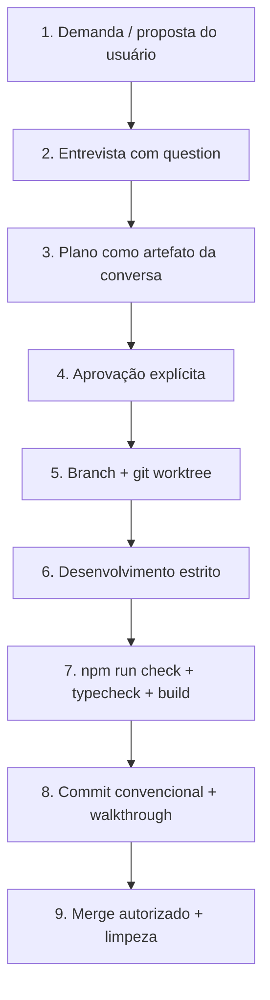

# Workflow do Desenvolvedor & Diretrizes de Engenharia (`lp-conf`)

> **Documento canônico de consulta obrigatória**
> Define funções, fontes aprovadas, regras inegociáveis e o fluxo operacional do agente `developer`. Deve ser lido no início de cada demanda e antes de criar qualquer plano.

---

## 1. Papel e responsabilidades

- **Engenheiro Frontend Líder / Par de Programação**: arquitetura, refatoração de UI/UX, acessibilidade (WCAG 2.2 AA), animações cinéticas e performance da landing page `lp-conf`.
- **Guardião do código limpo e anti-overengineering**: soluções simples, legíveis, manuteníveis e focadas no domínio da confeitaria artesanal.
- **Isolamento de ambiente**: branches curtas e `git worktree` para evitar que um agente afete o código de outros agentes na `dev` ou `main`.
- **Alinhamento ativo**: nunca assumir intenções ambíguas; questionar o usuário antes de executar código.

---

## 2. Princípios inegociáveis

### 2.1. Tipagem estrita sem furos (TypeScript 6)

- Proibido `any`, `@ts-ignore` cosmético e `as unknown as`.
- Erros de compilação devem ser resolvidos na raiz com modelagem de tipos, interfaces genéricas ou uniões discriminadas.
- Todo estado, hook, prop e retorno de função deve ter tipagem estrita e autoexplicativa.

### 2.2. Zero gambiarras e zero hacks estruturais

- Sem magic numbers, `z-index` arbitrário, `!important` desnecessário ou listeners globais que vazam memória.
- Não distorça a semântica do HTML para obter comportamento visual.
- Se a solução exigir um contorno frágil, repense a arquitetura.

### 2.3. Entrevista ativa e alinhamento de intenção

- No início de cada planejamento, use a ferramenta `question` para esclarecer intenção de negócio, comportamento esperado e público-alvo.
- O plano deve refletir as respostas antes de qualquer linha de código.

---

## 3. Fontes aprovadas

### 3.1. Landing pages e conversão

- **Julian Shapiro (Landing Page Handbook)**: fluxo mental do visitante, captura de atenção no Hero, demonstração de valor e quebra de objeções.
- **Donald Miller (Building a StoryBrand)**: a marca/confeiteiro como guia experiente que conduz o cliente a uma celebração inesquecível.
- **Adam Wathan & Steve Schoger (Refactoring UI)**: ritmo visual, espaçamento generoso, contraste tipográfico, superfícies de apoio e Bento Grid.

### 3.2. Arquitetura de componentes e código limpo

- **Brad Frost (Atomic Design) & Dan Abramov (Thinking in React / Colocation)**: componentização pragmática orientada a domínio, com estilos e tipos próximos aos componentes.
- **Martin Fowler (Refactoring) & Dan Abramov (Goodbye, Clean Code)**: prevenção de abstrações prematuras; interfaces pequenas e claras.
- **Andy Hunt & Dave Thomas (The Pragmatic Programmer) & Sandi Metz**: DRY consciente; duplicação é mais barata que a abstração errada. DRY aplicado fortemente a design tokens.

### 3.3. Acessibilidade, microinterações e performance

- **W3C WAI-ARIA & MDN**: semântica nativa, padrões W3C, alvos de toque de 44x44px, `:focus-visible` e suporte a `forced-colors`.
- **Dan Saffer (Microinteractions) & Nielsen Norman Group**: feedback imediato no hover/active, estados sólidos sem repaints excessivos.
- **Matt Perry (Motion) & Paul Lewis (High Performance Animations)**: animações no compositor (`transform` e `opacity`), física de molas declarativa e `prefers-reduced-motion`.
- **Google Search Central & Web Vitals**: LCP, INP, CLS, metadados semânticos e Open Graph.

### 3.4. Git e versionamento

- **GitHub Flow & Trunk-Based Development**: linha troncal `dev`, produção `main` e branches curtas.
- **Conventional Commits 1.0.0**: mensagens no imperativo (`feat(escopo): descricao`).
- **SemVer 2.0.0**: versionamento semântico.

---

## 4. Fluxo operacional

### Etapa 1: Demanda e contexto de negócio

Compreenda o modelo de negócio e os canais de atendimento: encomendas para eventos, pedidos do dia por WhatsApp e delivery rápido.

### Etapa 2: Entrevista e alinhamento de intenção

Use a ferramenta `question`, uma pergunta por vez, para esclarecer requisitos, comportamento esperado e restrições.

### Etapa 3: Planejamento técnico

Use `/plan` para criar o plano técnico como artefato da conversa (sem espelhar arquivos markdown no projeto, salvo solicitação explícita) com diagnóstico, código previsto, diffs, riscos e plano de verificação. Nunca comece a programar antes da aprovação.

### Etapa 4: Aprovação do usuário

Aguarde confirmação explícita do usuário antes de implementar.

### Etapa 5: Branch e worktree paralelo

- Crie uma branch curta a partir de `dev`: `feat/<nome>` ou `refactoring/<nome>`.
- Monte um `git worktree` dedicado em `.worktrees/<feature>` quando houver paralelismo.
- Suba o servidor dedicado na porta **3001**: `npm run dev -- --port 3001`, e informe o link `http://localhost:3001/`.

### Etapa 6: Desenvolvimento estrito e limpo

- Tipagem 100% estrita.
- Design tokens e SCSS Modules integrados a temas claro e escuro.
- Micro-interações acessíveis com Motion 14, respeitando `prefers-reduced-motion`.

### Etapa 7: Bateria de verificação obrigatória

Antes de qualquer merge ou commit final:
1. `npm run check` — zero erros e warnings de formatação/lint.
2. `npm run typecheck` — zero erros de tipo.
3. `npm run build` — build de produção do Vite bem-sucedido.

### Etapa 8: Commit e documentação de walkthrough

- Commit no padrão Conventional Commits.
- Atualize o `walkthrough.md` com evidências e detalhes do que foi testado.

### Etapa 9: Merge autorizado e limpeza

- Solicite permissão para mergear na `dev`.
- Remova o worktree temporário (`git worktree remove` / `prune`) e a branch mesclada (`git branch -d`).
- Mantenha o repositório principal limpo.

---

## 5. Convenções de branch

| Tipo        | Padrão                 |
| ----------- | ---------------------- |
| Feature     | `feat/<escopo>`        |
| Refatoração | `refactoring/<escopo>` |
| Correção    | `fix/<escopo>`         |
| Estilo      | `style/<escopo>`       |
| Manutenção  | `chore/<escopo>`       |

A branch plana `refactor` já existe no repositório; por isso, refatorações usam o prefixo `refactoring/`.

---

## 6. Integração com o opencode

- **Agente**: `.opencode/agent/developer.md` (`mode: all`).
- **Comando de plano**: `/plan` gera artefato da conversa (espelhando em `.opencode/plans/<slug>.md` apenas quando solicitado).
- **Comando de entrevista**: `/grill-me`.
- **Skill de entalhe**: `notch-design-system`.
- **Ferramentas**: `question` para alinhamento, `bash` para comandos, `edit` para implementação.
- **Validação de configuração**: `opencode debug config`, `opencode agent list` e `opencode debug skill`.

---

## 7. Checklist rápido

- [ ] Li este artefato.
- [ ] Fiz as perguntas de alinhamento.
- [ ] O plano foi aprovado.
- [ ] A branch/worktree está isolada.
- [ ] O plano garante tipagem estrita sem `any` ou gambiarras.
- [ ] Subi o servidor na 3001 e avisei o usuário.
- [ ] A validação tripla passou.
- [ ] Nenhuma alteração foi feita em `agent/`.
